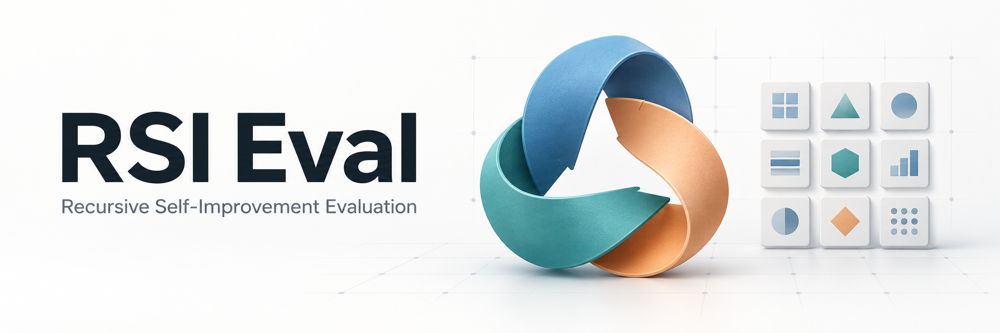

# RSI Eval

A lightweight Python SDK and CLI for evaluating recursive self-improvement (RSI)
methods across agent benchmarks. Bring your own improvement loop, choose your
tasks, and evaluate each candidate through one interface.

`candidate -> evaluate() -> task feedback -> your next candidate`

[Quick Start](#quick-start) · [Installation](#installation) ·
[Usage Examples](#usage-examples) · [Custom RSI Integration](#custom-rsi-integration) ·
[Custom Benchmark Integration](#custom-benchmark-integration)

## Why rsi-eval?

An RSI method needs to run candidates, collect feedback, and decide what to
change next. RSI Eval supplies the evaluation boundary so that your method can
use existing benchmarks without implementing their execution and result
handling from scratch.

- **Keep control of your method.** You choose candidate generation, memory,
  selection, stopping rules, and evolve/test tasks. Call `evaluate()` from your
  own loop; no optimizer base class is required.
- **Reuse benchmark protocols.** Select pinned tasks and run their graders.
  Raw rewards, task budgets, and benchmark-specific metrics retain their meaning.
- **Get usable feedback.** Read per-task scores, execution status, token usage,
  verifier output, and trajectory paths through a common result format.
- **Record and resume experiments.** Each evaluation snapshots the candidate,
  records task and source identities, and preserves results for explicit recovery.

The catalog contains **24 evaluation configurations and two labeled legacy
subsets**. It covers coding, reasoning, engineering, and domain workflows:

| Area | Bundled benchmark families | Guides |
| --- | --- | --- |
| Terminal and software engineering | Terminal-Bench 2.0/2.1, SWE-bench Verified, Multilingual and Pro, Aider Polyglot | [Additional coding benchmarks](docs/harbor-expansion.md) |
| Code generation | LiveCodeBench | [LiveCodeBench](docs/livecodebench.md) |
| Reasoning and mathematics | MMLU, GPQA, ARC-AGI, MGSM | [Reasoning](docs/reasoning-and-mce.md), [MGSM](docs/mgsm.md) |
| Reading comprehension | DROP | [DROP](docs/drop.md) |
| MCE tasks | FiNER, USPTO, Symptom2Disease, LawBench, AEGIS | [MCE](docs/reasoning-and-mce.md) |
| Engineering | EngDesign-Open, Frontier-Eng | [EngDesign](docs/engdesign.md), [Frontier-Eng](docs/frontier-eng.md) |
| Domain workflows | JobBench, Harvey LAB, APEX | [JobBench](docs/jobbench.md), [Harvey LAB](docs/harvey-lab.md), [APEX](docs/apex-agents.md) |

Use `rsi-eval list` for exact versions and task counts, or the
[configuration guide](docs/support-status.md) for prerequisites and method
objective requirements. Task selections belong to your experiment; the catalog
assigns no permanent evolve or test role.

Optional integrations provide ready-to-run **Meta-Harness, RRSI, AHE, and
HarnessX** workflows. The core SDK has no third-party runtime dependencies;
execution backends and method dependencies are installed when needed.

## Quick Start

Preview a one-task evaluation with Python 3.12 or newer:

```sh
git clone https://github.com/Danielxu0208/rsi_eval.git
cd rsi_eval
python3.12 -m venv .venv
source .venv/bin/activate
python -m pip install -e .

rsi-eval list
rsi-eval preview --config examples/evaluate.json
```

The example selects Terminal-Bench 2.0's `extract-elf` task and the bundled Codex
candidate. `preview` resolves the task references, candidate hash, and run
settings without Docker, Harbor, a login, or model calls.

For an actual evaluation, complete the execution setup below, then follow
[Run an evaluation](#run-an-evaluation).

## Installation

### Core and execution backend

The Quick Start installs the SDK and CLI from the checkout. To run benchmark
evaluations, install the Harbor extra in the same environment:

```sh
python -m pip install -e '.[harbor]'
```

This pins **Harbor 0.18.0**. Its executable must be on `PATH`, or specified through
`options.harbor_executable` in your run configuration. For a non-editable
installation, use `python -m pip install '.[harbor]'` instead.

The wheel includes the SDK, CLI, Codex candidate template, and four method
integrations. Upstream method repositories and benchmark assets are obtained
separately during preparation.

### Docker and task requirements

The default execution backend runs tasks in Docker. On Linux, install Docker
Engine with Compose and Buildx. On macOS, use Docker Desktop or a Colima Linux
VM. Verify access from the account that will run evaluations:

```sh
docker info
docker compose version
docker buildx version
```

For a dedicated Colima profile on Apple Silicon:

```sh
brew install colima docker docker-compose docker-buildx
colima start rsi-eval --cpus 6 --memory 12 --disk 120 \
  --vm-type vz --vz-rosetta --runtime docker --activate=false \
  --ssh-config=false --mount "$PWD:w"
source scripts/mac-env.sh
```

Adjust resources for your machine. Rosetta is required for this Colima command;
x86-only images need emulation on Apple Silicon. Set
`DOCKER_DEFAULT_PLATFORM=linux/amd64` when required by a task, and clear it for
configurations that select platforms per task.

Some tasks require an NVIDIA GPU, native Linux amd64, or external assets. See
[Frontier-Eng GPU setup](docs/frontier-eng.md#nvidia-gpu-setup) and
[EngDesign requirements](docs/engdesign.md). JobBench, Harvey LAB, and APEX require
separate native judge credentials, described in their guides. Check publisher
usage terms when choosing data for evolution; APEX is released for evaluation,
not training or parameter fitting.

### Codex access

With Codex CLI installed and available on `PATH`, create a dedicated,
file-backed login for experiments:

```sh
mkdir -p "$HOME/.codex-rsi-eval"
chmod 700 "$HOME/.codex-rsi-eval"
CODEX_HOME="$HOME/.codex-rsi-eval" codex \
  -c 'cli_auth_credentials_store="file"' login

rsi-eval configure --model YOUR_MODEL \
  --auth-dir "$HOME/.codex-rsi-eval" --output profile.json
```

Replace `YOUR_MODEL` with a model available to your account. `configure` probes
and records your Codex CLI version without calling a model. The profile stores
settings and the login directory's path; keep credentials outside candidate
artifacts and the repository.

The profile is used by the SDK example and bundled method commands below.
Direct CLI evaluations use their own run JSON, configured in the next section.
Other Harbor agents can use their own model and authentication setup.

## Usage Examples

Run these examples from the repository root with the virtual environment active.

### Run an evaluation

Edit [examples/evaluate.json](examples/evaluate.json) before running Codex:

- Set `target.model` to a model you can access.
- Set `target.config.codex_auth_dir` to your dedicated login directory.
- Set `target.config.codex_version` to the exact version recorded as
  `codex.expected_version` in `profile.json`.

Then check prerequisites, run the task's reference solution, and evaluate the
candidate:

```sh
rsi-eval check --config examples/evaluate.json
rsi-eval run --config examples/evaluate.json \
  --oracle --output runs/tb20-reference
rsi-eval run --config examples/evaluate.json \
  --output runs/tb20-candidate
```

`check` makes no model calls. `--oracle` runs the declared reference solution
without Codex, but still requires the task environment. Oracle availability and
expected scores depend on the benchmark. The final command runs the candidate
and consumes model quota.

Paths in run JSON resolve relative to the configuration file. CLI `--output`
paths resolve relative to your current directory. Use a new output directory
for each new evaluation.

### Choose benchmarks and tasks

```sh
rsi-eval status --benchmark terminal-bench@2.0 --method rrsi
rsi-eval preview --config examples/benchmarks/mgsm.json
rsi-eval preview --config examples/benchmarks/frontier-eng.json
```

Browse [examples/benchmarks](examples/benchmarks) for more configurations.
Selections accept explicit `task_ids` or a `manifest` containing a JSON list of
IDs, such as `["extract-elf"]`. Omitting both selects the entire declared
configuration. Check the task count and whole-job timeout before expanding a run.

Task-specific settings go in `options.benchmark_runtime`; the benchmark guides
list supported fields. Source-backed adapters download checksummed sources and
prepare Harbor tasks at execution time. To reuse source downloads, set
`RSI_EVAL_SOURCE_CACHE="$PWD/.runtime/source-cache"`.

### Use the Python SDK

The SDK uses the same target, selection, and options as the CLI:

```python
import json
from pathlib import Path
from rsi_eval import BenchmarkSelection, RunOptions, TargetSpec, evaluate

profile = json.loads(Path("profile.json").read_text())["codex"]
target = TargetSpec(
    artifact_dir=Path("templates/codex_agent"),
    entrypoint="rsi_eval.harbor_codex:Agent",
    model=profile["model"],
    config={
        "codex_auth_dir": profile["auth_dir"],
        "codex_version": profile["expected_version"],
        "reasoning_effort": profile["reasoning_effort"],
    },
)
result = evaluate(
    target=target,
    benchmark=BenchmarkSelection(
        "terminal-bench", "2.0", task_ids=("extract-elf",)
    ),
    options=RunOptions(repetitions=1, concurrency=1),
    output_dir=Path("runs/sdk-candidate"),
)
print(result.status)
for trial in result.trials:
    print(trial.task_id, trial.status, trial.reward)
print(result.report_path)
```

The bundled subscription Codex target requires `concurrency=1`. Custom Harbor
agents can implement other execution and model protocols.

### Run a bundled RSI method

Use the profile created during installation:

```sh
rsi-eval method list
rsi-eval method prepare --method meta-harness \
  --profile profile.json --experiment runs/meta-example
rsi-eval method check --experiment runs/meta-example
rsi-eval method run --experiment runs/meta-example
rsi-eval method test --experiment runs/meta-example --output runs/meta-test
```

`prepare` creates a separate dependency environment, fetches pinned upstream
code, and freezes the configuration and seed. It downloads packages and sources
without calling a model. `run` starts the native improvement workflow; `test`
independently evaluates its selected artifact.

Change `--method` to `rrsi`, `ahe`, or `harnessx`. Supply
`--config experiment.json` during preparation to choose tasks and method settings.

| Method | Workflow | Guide |
| --- | --- | --- |
| Meta-Harness | Candidate search, smoke evaluation, frontier and history feedback | [Meta-Harness](integrations/meta_harness/README.md) |
| RRSI | Analyst, proposer, critic, edit accounting and constrained selection | [RRSI](integrations/rrsi/README.md) |
| AHE | Debugger feedback, edit predictions, delayed attribution and best-candidate history | [AHE](docs/ahe.md) |
| HarnessX | Native tools and processors, MetaAgent evolution, evidence and smoke gates | [HarnessX](docs/harnessx.md) |

For continuous or heterogeneous rewards, check each method's objective
requirements. [Explicit score policies](docs/methods.md#choose-an-objective) adapt
method objectives while preserving raw benchmark rewards. See the
[method guide](docs/methods.md) for configuration, independent test selections,
and experiment export/import.

### Read results and resume

Each evaluation writes these artifacts under its output directory:

| Path | Contents |
| --- | --- |
| `result.json` | Unified status, per-task results, metrics and usage |
| `resolved.json` | Selected tasks, source references, candidate hash and settings |
| `candidate/` | The candidate snapshot submitted for execution |
| `native/eval/` | Harbor trials, verifier output and available trajectories |
| `harbor.log` | Backend process output |

`completed` includes measured zero rewards. `partial` and `failed` preserve
available results and explain missing work. Infrastructure and authentication
failures remain separate from graded outcomes. Benchmark-specific summaries
retain their native meaning; unrelated engineering objectives are reported per
task. Unknown token counts remain unknown.

After resolving an interruption, explicitly resume the recorded work:

```sh
rsi-eval resume --output runs/tb20-candidate
rsi-eval method resume --experiment runs/meta-example
```

Core recovery retries unfinished task repetitions and preserves completed
measurements and prior attempts. Method recovery follows each method's own
checkpoint and rollback behavior and may repeat calls in an interrupted round.
See [recovery details](docs/methods.md#recover-work). For prepared task and image
snapshots, see [runtime snapshots](docs/runtime-snapshots.md).

## Custom RSI Integration

Call `evaluate()` wherever your method needs candidate feedback. A minimal loop
can accept your own proposal and selection functions:

```python
from dataclasses import replace
from pathlib import Path
from rsi_eval import RunOptions, evaluate


def run_rsi(propose, select, *, target, benchmark, rounds, output_dir):
    history = []
    for index in range(rounds):
        candidate = Path(propose(history))
        result = evaluate(
            target=replace(target, artifact_dir=candidate),
            benchmark=benchmark,
            options=RunOptions(repetitions=1, concurrency=1),
            output_dir=Path(output_dir) / f"candidate-{index:03d}",
        )
        history.append({
            "candidate": result.resolved["target"]["snapshot_dir"],
            "feedback": result.to_dict(),
        })
        if result.status != "completed":
            raise RuntimeError(result.error or result.report_path)
    return select(history)
```

Pass a `TargetSpec` like the SDK example and your chosen `BenchmarkSelection`.
Your `propose(history)` returns a candidate directory; `select(history)` decides
which measured candidate snapshot to keep. These callbacks are local to this example;
your method can call the SDK directly in any control flow. Evaluate its selected
artifact on a separate test selection when needed. See
[examples/custom_method.py](examples/custom_method.py) for another complete loop.

For Codex candidates, copy [templates/codex_agent](templates/codex_agent) and edit
`agent.py`, `prompt.md`, or `tools/`. The required hook is
`build_prompt(instruction, artifact_dir) -> str`; the
[template guide](templates/codex_agent/README.md) documents optional hooks.
`evaluate()` snapshots each candidate automatically. Keep run output outside
candidate directories.

To use another Harbor agent, set `entrypoint="your_module:YourAgent"` and make
that module importable in Harbor's execution environment. If it loads candidate
files, accept an `artifact_dir` constructor argument and include that key in
`target.config`. The SDK replaces its value with the recorded candidate snapshot
path. Candidate Python hooks run in the trusted Harbor worker; commands passed
to the task environment run in its container.

## Custom Benchmark Integration

Register a pinned task specification, then use it through the same SDK. This
example creates a custom suite from an existing task while preserving its real
source reference:

```python
from copy import deepcopy
from rsi_eval import (
    BenchmarkSelection, TargetSpec, list_benchmarks, preview,
    register_benchmark,
)
from rsi_eval.resources import codex_template

base = next(
    spec for spec in list_benchmarks()
    if (spec["name"], spec["version"]) == ("terminal-bench", "2.0")
)
task = deepcopy(next(
    task for task in base["tasks"] if task["id"] == "extract-elf"
))
register_benchmark({
    "name": "my-terminal-suite",
    "version": "1",
    "dataset_ref": base["dataset_ref"],
    "tasks": [task],
})

selection = BenchmarkSelection("my-terminal-suite", "1")
plan = preview(
    target=TargetSpec(codex_template(), "oracle"),
    benchmark=selection,
    output_dir="runs/my-suite-preview",
)
print(plan["benchmark"]["task_ids"])
```

Use `selection` in `check()` or `evaluate()` in that same script.
`register_benchmark()` affects the current Python process; a separately started
CLI does not inherit its registrations. For a catalog available across CLI
processes, bundle it under `src/rsi_eval/data/catalog_*.json`.

### Add your own tasks

Package tasks in Harbor's format, with an instruction, `task.toml`, an environment,
and a verifier. Add a reference solution if you want oracle execution. Each
registered task needs an `id` and one of these source definitions:

| Task source | Required fields |
| --- | --- |
| Harbor package | `name` and `ref` containing an immutable `sha256:` digest |
| Git repository | `git_url`, full 40-character `git_commit_id`, and repository-relative `path` |

The specification also requires `name`, `version`, `dataset_ref`, and a nonempty
`tasks` list. See the [original catalog](src/rsi_eval/data/catalog.json) and
[additional Harbor catalogs](src/rsi_eval/data/catalog_harbor_expansion.json) for
concrete source definitions. Registration supplies task identities; the tasks
must supply working environments and graders.

For a new dataset format, add a materializer under `src/rsi_eval/materializers/`,
register it in that package's `MATERIALIZERS` table, and add its pinned source,
protocol, and task records to a catalog. Follow an
[existing materializer](src/rsi_eval/materializers/drop.py) for preparation and
preflight behavior. Keep reference answers private from the candidate, preserve
native metrics and grading rules, and declare any interaction changes. Add an
aggregation only when the benchmark defines one.

RSI Eval's original framework code is licensed under [Apache-2.0](LICENSE).
Third-party components and benchmark assets retain their own licenses; see
[third-party notices](THIRD_PARTY_NOTICES.md) for attribution and usage terms.
